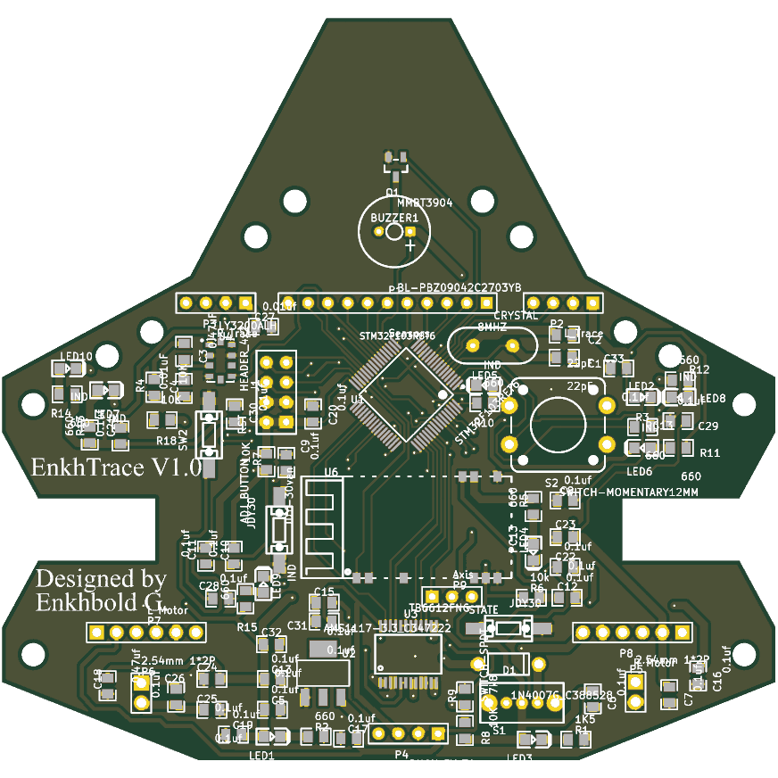
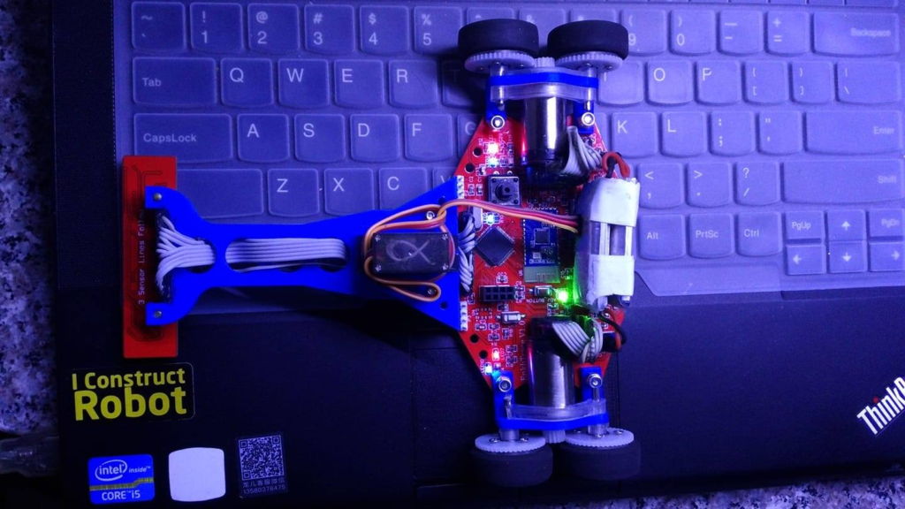
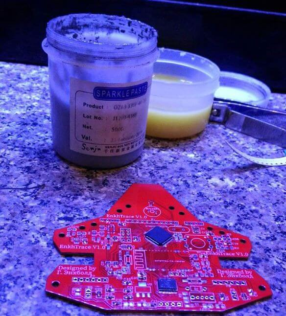
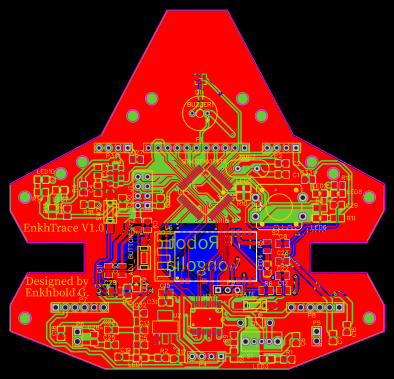
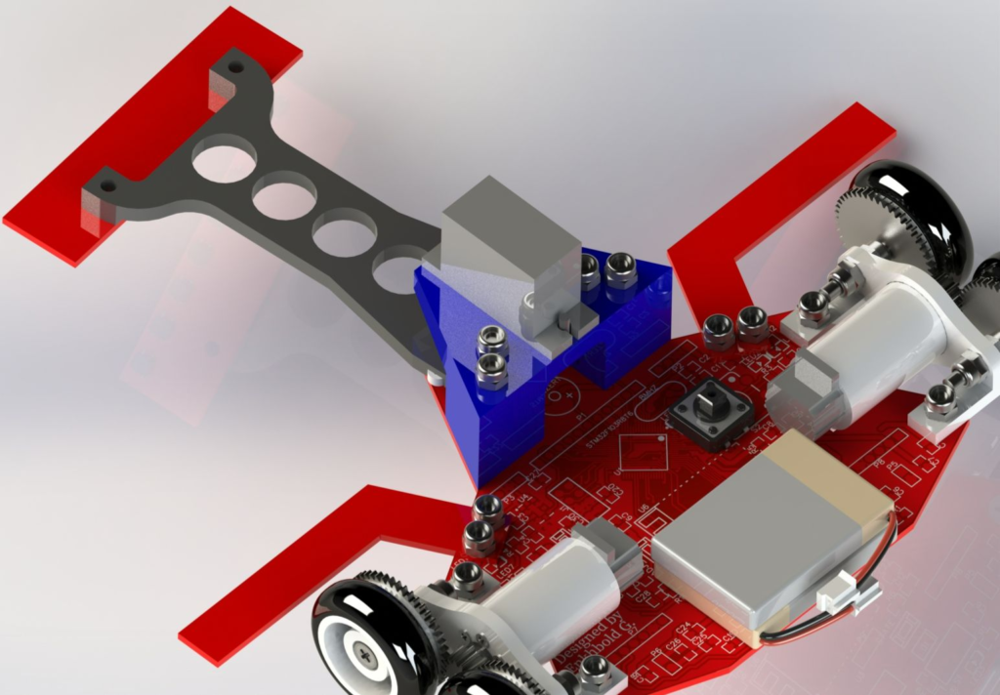

# EnkhTrace V1.0

A line-follower robot board built around an STM32F103RET6, with a TB6612FNG
motor driver for two motors, a sensor-array header, a JDY-30 Bluetooth module,
an LY3200ALH gyro, a buzzer and status LEDs. Designed by Enkhbold Ganbold for
the Erdenet robot challenge.

| | |
|---|---|
| Size | 99.2 × 95.3 mm |
| Layers | 2 copper |
| Footprints | 82 |
| Nets | 87 |

## Files

- `hardware/enkhtrace.kicad_pcb` — the board in KiCad 10 format.
- `easyeda/enkhtrace_pcb.easyeda.json` — the original EasyEDA Standard document.
- `firmware/Src/` — the STM32 firmware (STM32CubeMX / HAL project sources).
- `images/` — a render of the top side, plus photos of the first build, the
  soldering and the bare PCB.

## Build photos

 

## Firmware

`firmware/Src/` holds the sources for the STM32F103RET6: `main.c` and the
STM32CubeMX-generated `stm32f1xx_hal_msp.c`, `stm32f1xx_it.c` and
`system_stm32f1xx.c`. It is the source folder only; the CubeMX project file,
the HAL/CMSIS drivers and the headers are not included, so regenerate them with
STM32CubeMX for an STM32F103RETx before building.

## Where it came from

The board was drawn in EasyEDA Standard and published on OSHWLab:
<https://oshwlab.com/enkhbold470/line-follower-for-erdenet-robot-challenge>.
It was converted with KiCad 10.0.6's EasyEDA importer and its copper pours were
refilled. With the pours filled, KiCad's DRC finds every net connected; the
remaining DRC findings are silkscreen and clearance checks against KiCad's
default rules, not the rules the board was designed to. No schematic was
published with the original project, so none is included.

## Licence

MIT — see [LICENSE](LICENSE) — for the board, the images and the code written
for this project. The STM32CubeMX-generated parts of the firmware are
© STMicroelectronics under the BSD 3-Clause licence stated in each file's
header, and those headers are kept as they were.
